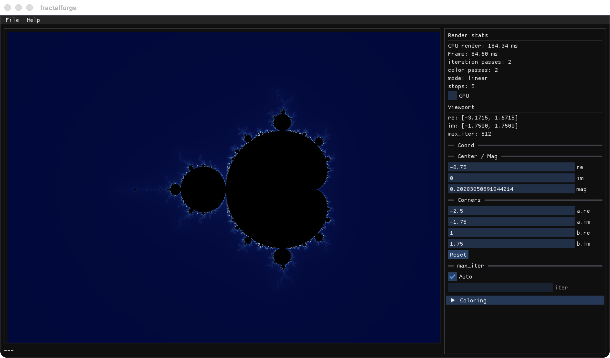

# Fractal Forge

Fractal Forge is a native Mandelbrot explorer for Apple Silicon Macs, written in Zig. Follow a spiral down to a view width of `1e-30`, inspect the Julia set for a point on its boundary, or turn a favorite view into a poster-sized PNG.



## Explore a view

- **Navigate.** Pinch to zoom around the pointer and pan with two fingers. Progressive rendering fills in detail as you settle on a view.
- **Inspect a point.** Open the Julia and orbit inspectors from the **View** menu. Move the pointer across the Mandelbrot boundary to see how the Julia set changes and where the orbit travels.
- **Choose the colors.** Start with a preset, edit its gradient stops, and switch between smooth and banded coloring. Save the palette separately to reuse it across pictures.
- **Return to a discovery.** Save a `.fractal` file to reopen the same coordinates, iteration settings, and palette. Export a PNG when you want a finished image.

## Build and run

Use Zig 0.15.2 and install SDL3 with Homebrew. The build looks for SDL3 under `/opt/homebrew`. Dear ImGui is vendored, and SDL compiles the embedded Metal shaders at runtime.

```sh
brew install sdl3
zig build
zig build run
```

Run `zig build test` for the full suite or `zig build test-gpu --summary all` for the headless Metal suite. Device-dependent tests skip when a Metal device is unavailable. See the [feature specifications](specs/README.md) for behavior and acceptance tests.

## Export a PNG

1. Choose **File → Export PNG…**. The width and height default to the fitted fractal image.
2. Enter the output dimensions and choose a filename. The app appends a missing `.png` suffix and asks before replacing an existing file.
3. Watch the row progress. Cancel before publication to preserve an existing destination. Completion shows the filename and dimensions.

Export rerenders the captured Mandelbrot view with its full-precision center, coloring and iteration limit. The center and complex-plane diagonal stay fixed. A different aspect ratio can crop one axis and reveal more on the other. The CPU runs one export at a time, and you can continue navigating while it works.

Each axis accepts 1–16,384 pixels, with at most 100,000,000 pixels total. The opaque RGB PNG uses stored DEFLATE blocks and takes about 3 bytes per pixel plus format overhead. A 7,200 × 10,800 headless export produced a 233,474,475-byte file (about 233 MB). Publication stages the full PNG alongside the destination, so allow room for both files when replacing one. Deep zooms and higher iteration counts can take longer. Print density can be set in the printing application.

## Deep-zoom rendering

Fractal Forge uses perturbation to explore beyond double precision. At a view width of `1e-6` or smaller, enable **BLA** in the Data panel to skip groups of iterations. Metal can accelerate eligible views, and the CPU handles depths beyond the GPU precision limit.

[Deep-zoom benchmarks and manual verification](docs/rendering-notes.md)

## Manual PNG export checks

The headless suite and poster-sized worker export passed. Native GUI verification is pending. [PNG export checklist](docs/rendering-notes.md#manual-png-export-checks)
